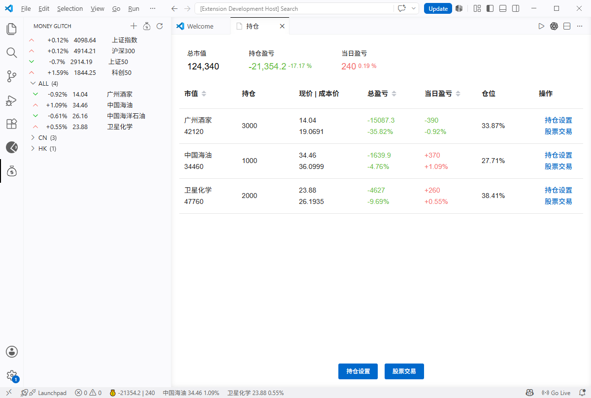

# money-glitch

* Real-time stock quotes
* Position profit and loss statistics

## Features

## Requirements

* vscode version at least 1.120.0

## Extension Settings

This extension contributes the following settings:

* `moneyGlitch.stockSymbols`: List of stock symbol.
* `moneyGlitch.statusBarStockSymbols`: List of stock symbol in statusBar.
* `moneyGlitch.position`: stock position detail
* `moneyGlitch.monthlyProfit`: 已结算的 A 股月度收益。手动调整此值会作为当月余额调整保留。

## 收盘结算与补录

扩展运行时，收到当日 A 股收盘行情后，按日期、股票保存收益记录，并更新 `monthlyProfit`。持仓即使移出自选，仍会获取行情。缺少某只股票的行情不会阻止其他股票结算，状态栏提示尚待结算的股票；后续刷新补齐记录，同日行情或交易修正会替换原记录，不会重复累计。

每月独立累计，月初显示从零开始。状态栏月收益包含本月已结算金额及当日尚未结算的 A 股盈亏，不包含港美股。账本保存在扩展本地状态中，旧版累计金额在升级时作为期初余额迁移。

扩展关闭期间不会后台获取历史行情。可在命令面板执行 **Money Glitch: 补录/修正每日收益**，输入日期及该日 A 股总盈亏。该操作替换该日自动记录，后续刷新保留手动金额；重复输入同一日期可再次修正。旧版迁移余额缺少逐日明细，已包含在其中的日期请通过调整 `monthlyProfit` 总额修正。

## 开发验证

运行 `npm test` 执行编译、lint 和不依赖行情网络的回归测试，覆盖交易校验、行情重试、市场调度、收益结算及缓存等场景。

## Known Issues

## Release Notes

### 1.0.0

* stock crud
* position crud
* profit statistic

## Following extension guidelines

Ensure that you've read through the extensions guidelines and follow the best practices for creating your extension.

* [Extension Guidelines](https://code.visualstudio.com/api/references/extension-guidelines)

## Working with Markdown

You can author your README using Visual Studio Code. Here are some useful editor keyboard shortcuts:

* Split the editor (`Cmd+\` on macOS or `Ctrl+\` on Windows and Linux).
* Toggle preview (`Shift+Cmd+V` on macOS or `Shift+Ctrl+V` on Windows and Linux).
* Press `Ctrl+Space` (Windows, Linux, macOS) to see a list of Markdown snippets.

## For more information

* [Visual Studio Code's Markdown Support](http://code.visualstudio.com/docs/languages/markdown)
* [Markdown Syntax Reference](https://help.github.com/articles/markdown-basics/)

**Enjoy!**
